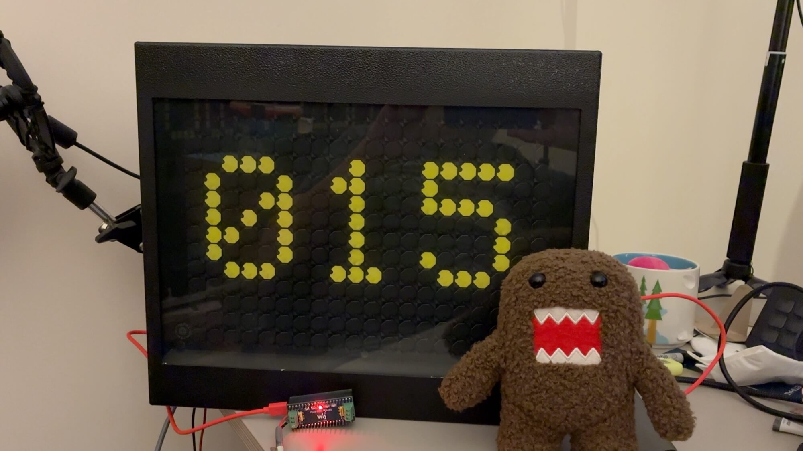

# mpflipdot



[Watch a video demo on YouTube](https://www.youtube.com/watch?v=nHq_gT024Bs).

A minimal MicroPython driver for [Hanover Displays](https://www.hanoverdisplays.com/) flip-dot signs,
aimed at a Raspberry Pi Pico with an RS485 adapter. No dependencies beyond MicroPython itself.

> **Status:** early but working. Verified on a 20x14 sign from a Pico W with the Waveshare Pico-2CH-RS485 (see
> [Tested hardware](#tested-hardware)). The Pico 2 W and the 84x7 sign have not been tested yet. See [PLAN.md](PLAN.md) for protocol notes and design.

## Features

- Configurable bus address, width, height (and upside-down mounting) per sign
- Clear / fill the display
- Start / stop the manufacturer's test mode (broadcast, address 0)
- Set a single dot on/off while retaining all others
- Set many dots (or the whole display) in one update

## Usage

```python
from mpflipdot import FlipDot, open_uart

uart = open_uart(0, tx=0, rx=1)          # any UART id / pins
sign = FlipDot(uart, address=6, width=20, height=14, row_offset=1)   # see "Sign quirks" below

sign.clear()
sign.set_pixel(10, 3, True)
sign.set_pixels([(0, 0, 1), (1, 1, 1), (2, 2, 1)])   # one frame sent
sign.test(True)                                      # manufacturer test mode
sign.test(False)
```

Other options: `row_offset=1` if the sign's top row is bit 1 instead of bit 0, `flip=True` (sign mounted
upside-down; rotates the picture 180° so (0, 0) stays your top-left), `auto_show=False` (batch changes, then call `sign.show()`), `de_pin=Pin(n, Pin.OUT)` for RS485
adapters without automatic direction control, `min_gap_ms=300` (see below). Every change resends the whole frame, because the protocol has no
per-dot command. `set_pixels` sends just one frame for the whole batch. Addresses are 0-15 (one hex digit on the
wire). Several signs on one bus: create one `FlipDot` per address sharing the same UART.

## Drawing helpers

`mpflipdot_draw.py` is installed alongside the driver and has plain functions that return `(x, y, on)` dots for
`set_pixels`, so a whole shape goes out as one frame:

```python
from mpflipdot_draw import line

sign.set_pixels(line(sign, 0, 0, 19, 13))                # width 1
sign.set_pixels(line(sign, 0, 0, 19, 13, width=3))
sign.set_pixels(line(sign, 0, 0, 19, 13, on=False))      # erase the same line
```

```python
from mpflipdot_draw import rect, circle

sign.set_pixels(rect(sign, 2, 3, 10, 6))                       # top-left corner x, y, then width, height (outline)
sign.set_pixels(rect(sign, 2, 3, 10, 6, solid=True))
sign.set_pixels(circle(sign, 10, 7, 5))                        # centre x, y, then radius (outline)
sign.set_pixels(circle(sign, 10, 7, 5, solid=True, on=False))  # a hole: switch the dots off
```

Rectangles and circles are outlines one dot thick unless you pass `solid=True`. A circle is `2 * radius + 1` dots across
(`radius=0` is a single dot), and its outline is exactly the edge of the solid one. Lines, rectangles and circles are
all clipped to the sign, and dots later in a list override earlier ones, so you can combine shapes in one frame:
`set_pixels(list(rect(...)) + list(circle(..., on=False)))`.

Lines are clipped to the sign, so one that runs past the edge draws the visible part. Width is added across the line
along its minor axis, so a diagonal comes out about 0.7 of the width you ask for, and an even width puts the extra dot
below or to the right of the centre line.

## Text

`mpflipdot_text.py` (also installed with the driver) has a 5x7 font and works the same way as the drawing helpers: its
functions return `(x, y, on)` dots for `set_pixels`, clipped to the sign.

```python
from mpflipdot_text import text, scroll, text_width

sign.set_pixels(text(sign, "HI!", 1, 3))              # top-left corner of the text at x=1, y=3
sign.set_pixels(text(sign, "OK", 2, 0, scale=2))      # whole-number scale: 2 gives 10x14 characters
sign.set_pixels(text(sign, "HI!", 1, 3, on=False))    # erase it again
scroll(sign, "HELLO WORLD", y=3)                      # once right to left, one frame per step, ends blank
scroll(sign, "BIG", y=0, scale=2, step=3)             # step = dots moved per frame (default 2)
width = text_width("HELLO", scale=1)                  # in dots, e.g. to centre text
```

- Characters are 5 dots wide with a 1-dot gap, so a 20-dot-wide sign fits three at scale 1. Scrolling is how you show more.
- The font covers ASCII space to `Z`: `A-Z`, `0-9`, space, and `! " # $ % & ' ( ) * + , - . / : ; < = > ? @`. Lowercase is
  drawn as uppercase, and any other character is blank. The table is about 300 bytes.
- To draw text on a blank sign in one frame, make the sign with `auto_show=False`, then
  `sign.clear(); sign.set_pixels(text(...)); sign.show()`. With `auto_show=True` each of those calls sends its own frame.
  `scroll` handles that itself.
- `scroll_frames(sign, string, y, scale, step)` yields the dots for each frame, if you want to do something between frames.
  The frame rate is set by the driver's `min_gap_ms`, so about 3 frames a second: a larger `step` scrolls faster.

## Examples

- `examples/basic.py`: clear, single dots, a batch update and test mode.
- `examples/text.py`: positioned text, a counter, and scrolling text at scale 1 and 2.
- `examples/bounce.py`: a ball bouncing round the sign forever; Ctrl-C clears the sign and stops it.
- `examples/shapes.py`: loops through rect and circle demos (growing and nested rectangles, circles, a target, a bouncing ball, a hole punched in a solid block).
- `examples/lines.py`: loops through line demos (widths, a cross, spinning lines, a fan, lines clipped at the edges).
- `examples/demo.py`: loops through patterns (sweeps, boxes, checkerboard, diagonal wipe, sparkle, flash) as fast as
  the sign allows. Run it with `mpremote run examples/demo.py`; edit `W`, `H` and `address` first for your sign.
  Stop it with Ctrl-C, or `mpremote soft-reset` if it's detached.

## Tested hardware

| | |
|---|---|
| Board | Raspberry Pi Pico W, MicroPython 1.29.0. **Not yet tested on a Pico 2 W** (the driver imports and runs there, but it hasn't driven a sign); that's planned |
| RS485 | Waveshare Pico-2CH-RS485, channel 0 (UART0, GP0/GP1), sign data red on A, black on B. No direction pin needed |
| Sign | 20x14, rotary switch SW2 on 5, 24 V / 5 A supply |
| Verified | `fill`, `clear`, `set_pixel` (state retained), `set_pixels`, `test(True/False)`, `flip=True` (an L at (0,0) appeared in the opposite corner), `examples/demo.py` and `examples/lines.py` on the sign, `mpflipdot_draw.line`, 0.3 s between frames and the `min_gap_ms` guard (a 0.2 s loop was slowed to 0.3 s and every row showed) |
| Not yet tested | a Pico 2 W driving a sign, the 84x7 sign, `de_pin`, several signs on one bus |

## Sign quirks

These came out of testing on the 20x14 sign and may differ on other signs, so check yours:

- **Address is the rotary switch plus 1.** Switch on 5 means `address=6`. Address 0 is broadcast, and test mode always uses it.
- **Row offset.** On the 20x14 sign the top row is bit 1 of each column, not bit 0, so use `row_offset=1`.
  With `row_offset=0` the bottom row stays off. If a row is missing on your sign, try a different offset.
- **All-zero frames are ignored.** A frame with no dots set does nothing, so a plain "clear" would never take effect.
  When a frame would be all zero, `show()` sets one bit that lights no dot (bit 0 with `row_offset`, or the first
  spare bit above the rows), and the display clears as expected. The 84x7 sign is untested.
- **Power it properly.** A 24 V / 1 A supply made the sign drop frames at random, which looked like a signalling
  problem. A 24 V / 5 A supply fixed it. If frames go missing, check the supply before the wiring.
- **Update rate.** Wait at least about 0.3 s between frames. At 0.2 s the sign skipped frames. One frame takes about
  0.18 s just to send at 4800 baud (84x7 frames are the same size or smaller, so should do no worse). The driver
  enforces this: `min_gap_ms=300` makes a send wait until that long after the previous one, so a fast loop is slowed
  down, not dropped, and the last update always lands. Use `min_gap_ms=0` to turn it off.
- **USB-RS485 adapters on a computer** (for debugging): keep the port open for a few seconds after the last write,
  or the final frame can be lost.

## Hardware

- Raspberry Pi Pico W or Pico 2 W running MicroPython
- [Waveshare Pico-2CH-RS485](https://www.waveshare.com/pico-2ch-rs485.htm) (SP3485): channel 0 = UART0 on GP0/GP1, channel 1 = UART1 on GP4/GP5
- Hanover Displays flip-dot sign, 4800 baud serial, powered from a **24 V / 5 A** supply. A 24 V / 1 A supply made it drop frames
  at random, so don't skimp on current (see [Sign quirks](#sign-quirks))
- MicroPython **1.29.0** (tested on the Pico W; the Pico 2 W is untested with a sign but planned). Older releases are untested; roughly 1.20+ is expected to work
  (`mip` install and `UART.flush()`, which is only used with `de_pin`), but that hasn't been verified.

## Install

```
mpremote mip install github:simonprickett/mpflipdot
```

(verified on a Pico W: it installs `/lib/mpflipdot.py`), or, on the board: `import mip; mip.install("github:simonprickett/mpflipdot")`. Or just copy `mpflipdot.py` to the board.

Run the tests (CPython, no hardware): `python3 -m unittest discover -s tests`.

## Acknowledgements

Protocol details were worked out by studying [pyflipdot](https://pypi.org/project/pyflipdot/).

## License

[MIT](LICENSE)
